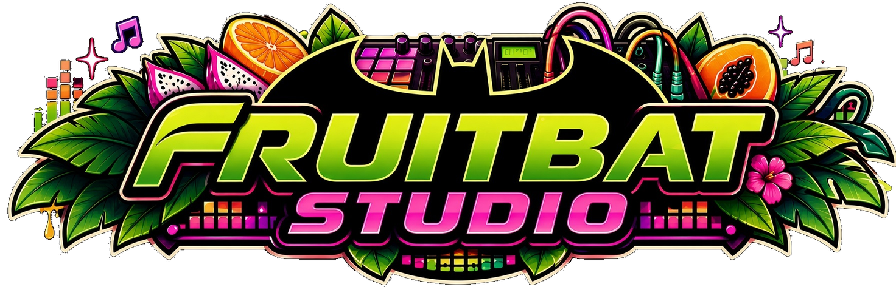
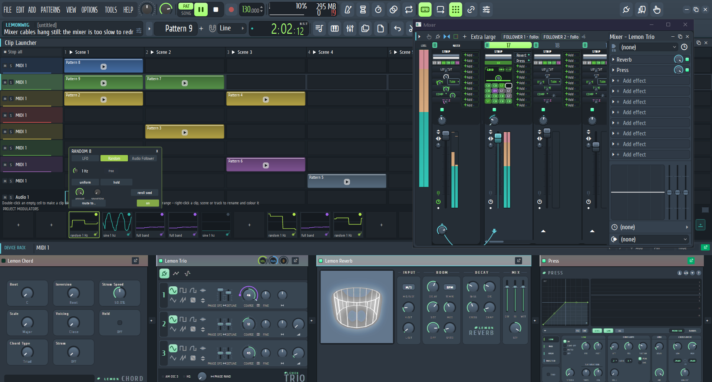
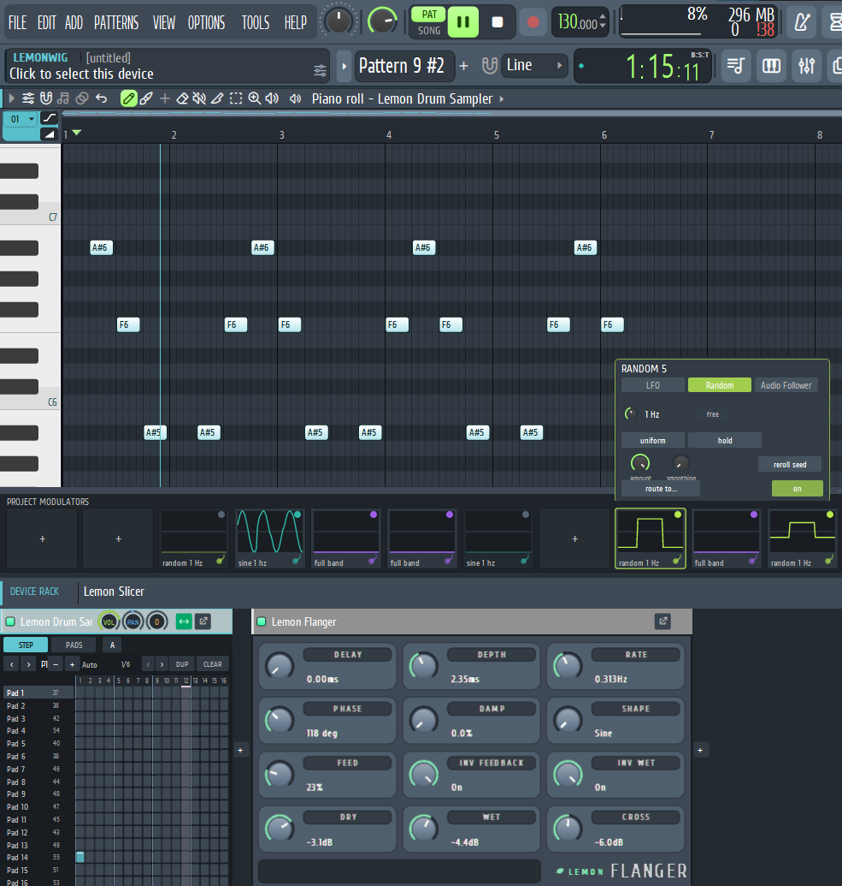
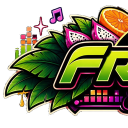

<div align="center">



# 🦇🍊 FruitBat Studio

**A hybrid pattern-based & modular DAW, built in Rust.**

<p>
  <a href="LICENSE"></a>
  
  
  
</p>

</div>

> **A hybrid pattern-based & modular music workstation.** Merging the lightning-fast pattern stamping and channel rack
> ergonomics of classic pattern sequencers with the deep, cable-routed modulation and routing paradigms of modular
> workstations — running natively on Windows, Linux and macOS.

## 📸 Screenshots

<div align="center">



<sub>The clip launcher, mixer, project modulators and device rack, all in one workspace.</sub>

<br><br>



<sub>The piano roll, the project modulation strip and docked device editors.</sub>

</div>

---

## ✨ Features

- **Hybrid workflow:** fast pattern-based sequencing combined with modular signal routing and live parameter
  modulation.
- **Native audio engine:** a sample-accurate Rust engine with a fast CPU-rendered interface, running with WASAPI/ASIO,
  ALSA and Core Audio.
- **Modular patching:** connect LFOs, random sources and audio followers to instrument, effect and mixer parameters on
  the fly.
- **FL Studio projects:** opens and saves `.flp` files, although that support is still young — work on copies and keep
  backups.
- **Clip launcher:** scenes, clips, launch quantisation and keyboard navigation, alongside the classic playlist.
- **Custom UI aesthetic:** deep botanical greens, passionfruit purples and midnight obsidian styling, with Meridian,
  Lemon, Lemon Industrial and Citrus skins.
- **Plugin hosting:** CLAP, VST3 and VST2 instruments and effects with their own editors.

The honest, tested picture of what is and is not finished lives in
[docs/AUDIT-2026-11-14-fruitbat.md](docs/AUDIT-2026-11-14-fruitbat.md). This is pre-alpha software: expect rough edges
and greyed-out controls that are not implemented yet.

---

## 🚀 Quick Start (Local Development)

FruitBat Studio is a Rust workspace. Install the stable Rust toolchain with [rustup](https://rustup.rs/), then:

```bash
# Clone the repository
git clone https://github.com/Chimthuwu/Lemonwig-Studio.git
cd Lemonwig-Studio

# Build and run the app
cargo run -p os-app --release
```

The release binary is written to `target/release/lemonstudio.exe` on Windows (or `target/release/lemonstudio` on Linux
and macOS). The binary keeps the `lemonstudio` name so existing projects, shortcuts and scripts continue to work.

To skip rebuilding the bundled plugins while iterating:

```bash
OPENSTUDIO_NO_PLUGIN_BUILD=1 cargo run -p os-app --release
```

### Windows prerequisites

- The Microsoft C++ build tools and Windows SDK that Rust uses.
- LLVM (`winget install LLVM.LLVM`) for the time stretcher and ASIO bindings.

### Linux prerequisites

```bash
sudo apt install g++ libclang-dev libasound2-dev libjack-jackd2-dev libwayland-dev pkg-config
```

macOS needs the Xcode Command Line Tools (`xcode-select --install`). More platform detail is in
[docs/status.md](docs/status.md).

---

## 🛠️ Tech Stack

- **Language:** Rust 2024 edition.
- **Application:** `os-app` — windows, editors, transport and the CPU-rendered UI.
- **Audio Engine:** `os-engine` / `os-dsp` — sampler, mixer, routing, effects, envelopes and automation.
- **Project files:** `os-flp` — a lossless FL Studio `.flp` event-stream reader/writer.
- **Plugin hosting:** `os-host`, `os-clap`, `os-vst3`, `os-vst2`.
- **Interface:** `os-ui` — canvas, text rendering and the shared widget kit; `os-theme` for skins and themes.
- **Bundled instruments and effects:** Lemon Sampler, Lemon Trio, Citrus, Lemon Drum Sampler, Lemon Slicer, Tesla and
  the Lemon effect suite.

---

## 📦 Installing

### Windows

```powershell
cargo install --path crates/os-app
$link = (New-Object -ComObject WScript.Shell).CreateShortcut("$env:APPDATA\Microsoft\Windows\Start Menu\Programs\FruitBat Studio.lnk")
$link.TargetPath = "$env:USERPROFILE\.cargo\bin\lemonstudio.exe"
$link.Save()
```

### Linux

```bash
cargo install --path crates/os-app
install -Dm644 crates/os-app/assets/lemonstudio.png ~/.local/share/icons/hicolor/256x256/apps/lemonstudio.png
install -Dm644 crates/os-app/assets/lemonstudio.desktop ~/.local/share/applications/lemonstudio.desktop
```

Settings, themes and presets live in `%APPDATA%\Lemon Studio` on Windows, `$XDG_CONFIG_HOME/Lemon Studio` on Linux and
`~/Library/Application Support/Lemon Studio` on macOS. `OPENSTUDIO_USER_DIR` overrides the folder. The folder keeps its
old name so existing settings survive the rebrand.

---

## 🤝 Contributing

Contributions, feature requests and modular experiments are welcome. Open an issue or submit a pull request if you want
to add modulation sources, custom effects or UI improvements.

All contributions must be **clean-room** work: decompiled code, or code derived from decompiled output, cannot be
accepted. Contributors keep the copyright of their work and license it under the GPL, version 3 or later; add your name
to the header of each file you substantially change.

---

## 📜 License

Copyright (C) 2026 ItsAlphaNeon, Chimthuwu and the FruitBat Studio contributors.

FruitBat Studio is free software: you can redistribute it and/or modify it under the terms of the
[GNU General Public License](LICENSE), version 3 or (at your option) any later version. It is distributed in the hope
that it will be useful, but WITHOUT ANY WARRANTY; without even the implied warranty of MERCHANTABILITY or FITNESS FOR A
PARTICULAR PURPOSE.

Third-party components keep their authors' copyright and licences; their notices are in
[THIRD-PARTY-NOTICES.txt](THIRD-PARTY-NOTICES.txt). FL Studio is a trademark of Image-Line Software. FruitBat Studio is
an independent project and is not affiliated with, sponsored by or endorsed by Image-Line.

<div align="center">
<br>

<br>
<sub>FruitBat Studio — free software under the GNU GPL, version 3 or later.</sub>
</div>
