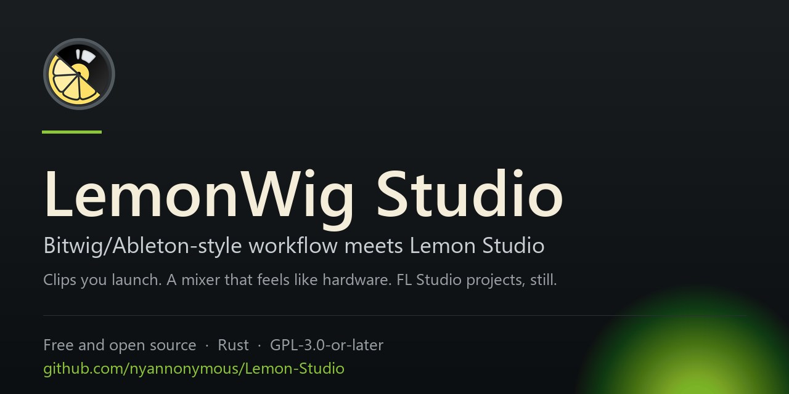

# Sharing LemonWig Studio

When someone pastes a link to this repository into Twitter / X, Discord, Slack or Bluesky, the card they see is built
from three things on GitHub: the repository's **description**, its **social preview image**, and the first lines of
this README. Set them once, with the copy below, and every share looks right.

All of it is on the repository page: **Settings ▸ General**, and the **About** box on the main page.

---

## 1. The description

The one-line description is the title of every card. Keep it short — GitHub shows about 160 characters, Discord and
Twitter cut it off sooner.

**Paste this:**

```
LemonWig Studio — Bitwig/Ableton-style workflow meets Lemon Studio: launch clips, fire scenes, mix on a console that feels like hardware.
```

If you want a little more room (the GitHub About box allows 350 characters), use this instead:

```
LemonWig Studio — a performance-first take on Lemon Studio. Clips and scenes you launch, a mixer that behaves like a hardware console, the original projects still open. Free and open source, written in Rust.
```

**Website** (shown on the card as a link):

```
https://github.com/nyannonymous/Lemon-Studio
```

---

## 2. The image

Twitter / X and Discord show a large card when a repository has a social preview image and a small one when it does
not. Ours is:

```
docs/assets/social-preview.png
```

1280 × 640 pixels, 2:1, which is the size GitHub asks for and what both Twitter and Discord crop to.

**To set it:** Settings ▸ General ▸ **Social preview** ▸ *Edit* ▸ **Upload an image** ▸ choose that file.

While you are there, put the same words in the image's **alt text** so shares are described for screen readers:

```
LemonWig Studio: Bitwig/Ableton-style workflow meets Lemon Studio. Clips you launch, a mixer that feels like hardware, the original projects.
```

---

## 3. The topics

Topics are what GitHub's own search and the repository sidebar show. Paste these in the **About** box's gear:

```
daw  digital-audio-workstation  rust  bitwig  ableton  fl-studio  music-production  audio  vst3  clap
```

---

## What the cards look like

**Twitter / X and Discord** (with the image set):

> **LemonWig Studio — Bitwig/Ableton-style workflow meets Lemon Studio**
> Launch clips, fire scenes, mix on a console that feels like hardware.
> `github.com/nyannonymous/Lemon-Studio`
> 

**Discord, image off or not yet cached** — the name, the description and the link, which is why the description above
is written to read on its own.

---

## If a share looks out of date

Discord and Twitter keep cards for a while. To force a fresh one, post the link with a query on the end:

```
https://github.com/nyannonymous/Lemon-Studio?v=2
```

Discord's own trick is to paste the link, delete the message, and paste it again — the second post reads the new
description and image.

---

## Crediting people in shares

Posts about the project should credit the repository, and the people behind it:

- **Lemon Studio** — [AlphaNeon](https://github.com/ItsAlphaNeon), the original project this work is built on.
- **This fork** — the Lemon Studio and LemonWig Studio contributors listed in the README.

A line like this covers it:

> LemonWig Studio: Bitwig/Ableton-style workflow meets Lemon Studio, by AlphaNeon and the Lemon Studio contributors.
> https://github.com/nyannonymous/Lemon-Studio
